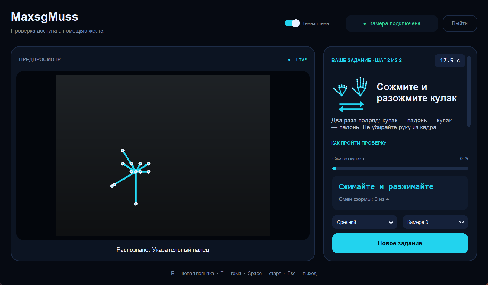
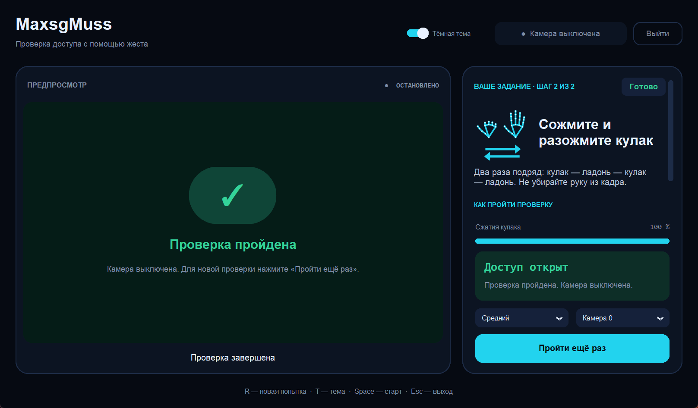
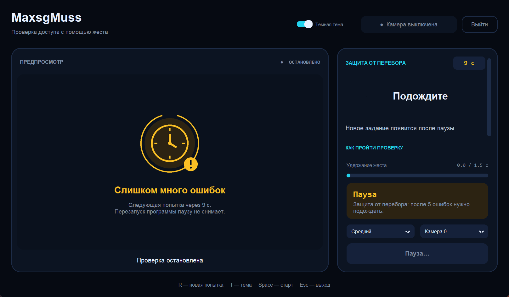
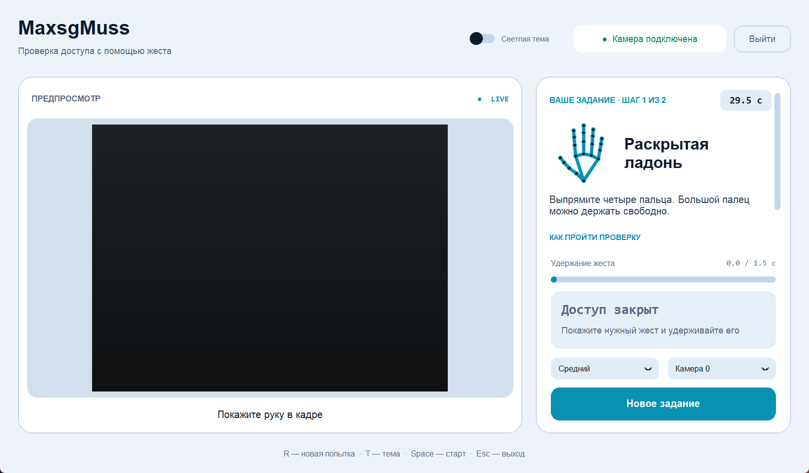

# MaxsgMuss — жестовая капча с веб-камерой

Учебный проект первого семестра по предмету «Реализация проекта в области информационной безопасности с
использованием технологии компьютерного зрения». Программа даёт случайное задание жестом руки, следит за рукой
через веб-камеру и открывает условный доступ в своём окне, только если задание выполнил живой человек.



Версия 2.3. Скриншоты в README сделаны с имитацией камеры (тёмный кадр), скелет руки нарисован поверх него так же,
как поверх настоящего видео.

## Что умеет

- **Семь жестов**: ладонь, знак V, указательный палец, три пальца, знак рока, кулак, большой палец вверх.
- **Защита от фото руки**: после жеста нужно дважды сжать и разжать кулак. Пальцы на фото не согнуть.
- **Защита от перебора**: после 5 ошибок — пауза 10 → 30 → 60 секунд. Перезапуск программы паузу не снимает.
- **Три уровня сложности**: «Лёгкий», «Средний», «Сложный».
- **Подсказки в реальном времени**: что распознано и что мешает — «рука далеко», «рука у края кадра»,
  «держите кисть ровно».
- Скелет руки поверх видео, картинка нужного жеста, светлая и тёмная темы, горячие клавиши.
- Видео никуда не записывается и не отправляется: всё работает локально.

## Скачать готовую программу (Windows)

На странице [релиза](https://github.com/0verLorD228/MaxsgMuss/releases/latest) лежит `MaxsgMuss-2.3.exe` — один
файл, Python не нужен.

- Файл большой (около 230 МБ): внутри нейросеть MediaPipe, OpenCV и сам Python.
- Первый запуск занимает 10–20 секунд: exe распаковывается во временную папку.
- Exe не подписан, поэтому Windows SmartScreen может написать «Windows защитила ваш компьютер». Нажмите
  «Подробнее» → «Выполнить в любом случае».
- Контрольная сумма SHA-256 указана на странице релиза. Сверить её можно в PowerShell:
  `Get-FileHash .\MaxsgMuss-2.3.exe`.

## Как запустить из исходников (Windows)

Нужны веб-камера и **Python 3.11 или 3.12, 64-bit** ([python.org](https://www.python.org/downloads/windows/);
при установке включите Tcl/Tk и Python Launcher).

**Проще всего:** дважды щёлкните `run_MaxsgMuss.bat`. Он создаст окружение `.venv312`, установит библиотеки из
`requirements.txt` и запустит программу. Первый запуск занимает несколько минут.

**Вручную, в терминале в папке проекта:**

```bat
py -3.12 -m venv .venv312
.venv312\Scripts\python.exe -m pip install -r requirements.txt
.venv312\Scripts\python.exe MaxsgMuss.py
```

Версии библиотек закреплены. Главное — `mediapipe==0.10.21`: это последняя версия со старым API `mp.solutions`,
на котором написана программа. На Python 3.13 и новее она не устанавливается.

## Как пройти проверку

1. Покажите одну кисть целиком, ладонью к камере, пальцами вверх. Нужен ровный свет.
2. Выполните жест из задания и держите его 1,5 секунды (на «Сложном» — 2 секунды).
3. На «Среднем» и «Сложном» уровнях дважды сожмите и разожмите кулак, не убирая руку из кадра.
4. На «Сложном» уровне дополнительно сдвиньте руку в указанную сторону или помашите.

| Уровень | Шаги | Время |
| --- | --- | --- |
| Лёгкий | жест | 40 с |
| Средний (по умолчанию) | жест → сжать и разжать кулак | 30 с |
| Сложный | жест (держать 2 с) → сжать и разжать кулак → движение | 30 с |

Горячие клавиши: `R` — новое задание, `T` — тема, `Space` — начать после остановки, `Esc` — выход.

## Как это работает

```text
веб-камера → OpenCV (кадр) → MediaPipe Hands (21 точка кисти) → правила на Python (жест, шаги, ошибки) → окно
```

- **OpenCV** читает кадры с камеры и отражает их, как в зеркале.
- **MediaPipe Hands** — готовая нейросеть Google: находит на кадре кисть и 21 точку (запястье, суставы, кончики
  пальцев). Обучать свою модель не нужно.
- **`recognize_gesture()`** определяет жест: для каждого пальца сравнивает высоту кончика и среднего сустава.
  Кончик выше — палец поднят.
- **`FlexChallenge`** считает смены «кулак ↔ ладонь» и сбрасывает счёт, если рука пропала из кадра дольше 0,3 с,
  резко прыгнула или пальцы двигаются слишком медленно.
- **`Lockout`** хранит счётчик ошибок в `%APPDATA%\MaxsgMuss\lockout.json`: только число ошибок, ступень паузы
  и время её окончания.

## От чего защищает и от чего нет

| Атака | Что происходит | Итог |
| --- | --- | --- |
| Фото руки с нужным жестом | Проходит первый шаг, но не может сжать кулак | Защищает (с уровня «Средний») |
| Фото на телефоне, телефон двигают | Движение телефона не сгибает пальцы | Защищает (проверено на камере) |
| Листание двух фото (ладонь и кулак) | Рука пропадает или прыгает — счёт сбрасывается | Сильно затрудняет |
| Перебор всех жестов подряд | После 5 ошибок пауза 10 → 30 → 60 с | Защищает |
| Перезапуск программы во время паузы | Пауза читается из файла | Защищает |
| Удаление файла счётчика | Счётчик начинается с нуля | Не защищает |
| Видео, где рука сжимается и разжимается | Выглядит как живая рука | Не защищает |
| Подмена видеопотока или изменение кода | Программа работает локально | Не защищает |

На уровне «Лёгкий» шага со сжатиями нет, поэтому фото его проходит. Это сделано специально, чтобы показать атаку
и разницу между уровнями.

**Что пробовали и отказались.** Сначала фото отличали по «дрожи»: казалось, что точки на фото неподвижны, а живая
рука слегка дрожит. Измерение на настоящей камере показало обратное: на фото с экрана телефона нейросеть находит
руку неуверенно, и точки скачут сильнее (медиана разброса 0,16–0,26), чем дрожит живая рука (0,05). Метод убрали.
Потом пробовали шаг «сдвиньте руку в сторону», но его проходило фото, если двигать сам телефон. Тогда появился шаг
«сожмите и разожмите кулак».

«Доступ открыт» — надпись внутри программы. Она ничего не разблокирует в Windows и не устанавливает личность.
Это учебный прототип жестовой капчи, а не готовая система защиты.

## Скриншоты

| Доступ открыт | Пауза после перебора | Светлая тема |
| --- | --- | --- |
|  |  |  |

## Проверка

```bat
.venv312\Scripts\python.exe -m unittest discover -s tests
.venv312\Scripts\python.exe tests\ui_smoke.py
```

- `tests/test_*.py` — 67 проверок логики без камеры: жесты, подсказки, сжатия, движения, пауза, уровни, картинки.
- `tests/ui_smoke.py` — настоящее окно с поддельными камерой, нейросетью и часами: 13 сценариев, включая атаки
  фото и перебором. Скриншоты сохраняются в `_shots/`.

Живая камера проверялась вручную: все уровни, фото на телефоне, перебор и пауза после перезапуска.

## Если что-то не запускается

| Ситуация | Что сделать |
| --- | --- |
| `No matching distribution found for mediapipe` | Нужен Python 3.11 или 3.12, 64-bit |
| `module mediapipe has no attribute solutions` | Установлена другая версия: выполните `pip install -r requirements.txt` |
| Камера не открывается | Закройте другие программы с камерой, проверьте доступ к камере в параметрах Windows, выберите другую камеру в списке |
| Жест не распознаётся | Читайте подсказку под видео: обычно рука далеко, у края кадра или наклонена |
| Счёт сжатий сбрасывается | Не убирайте руку из кадра и сжимайте быстрее — не дольше 1,5 с между сменами |

## Источники и лицензии

- Сравнение кончиков пальцев с суставами адаптировано из метода `fingersUp` проекта
  [CVZone 1.6.1](https://github.com/cvzone/cvzone) (Vizdx LLC / Computer Vision Zone, лицензия MIT). Полный текст
  лицензии сохранён в начале `MaxsgMuss.py`.
- [MediaPipe Hands](https://chuoling.github.io/mediapipe/solutions/hands.html),
  исходный проект — [google-ai-edge/mediapipe](https://github.com/google-ai-edge/mediapipe) (Apache 2.0).
- [OpenCV](https://opencv.org/) (Apache 2.0), [CustomTkinter](https://github.com/TomSchimansky/CustomTkinter) (MIT),
  [Pillow](https://python-pillow.org/) (MIT-CMU), [NumPy](https://numpy.org/) (BSD).

Окно, задания, защита от фото и перебора, подсказки и тесты написаны для этого проекта.
